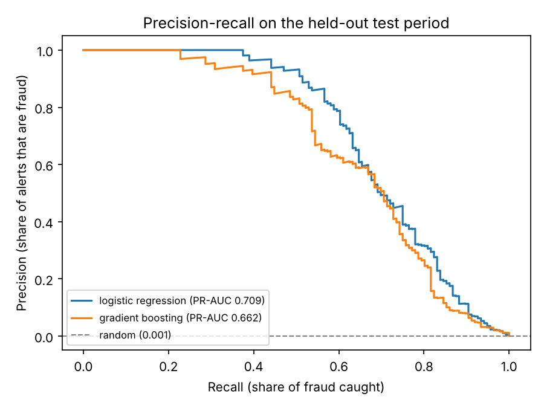
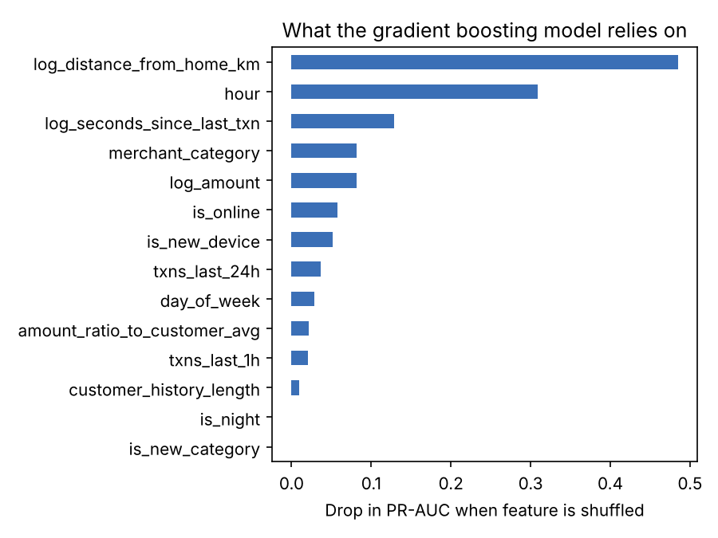

# FraudGuard: card transaction fraud detection


An end-to-end machine learning system that flags fraudulent card transactions in real time: from raw
transactions, through behavioural feature engineering and cost-aware model selection, to a REST API,
an interactive demo and a Jenkins CI/CD pipeline with a model quality gate.

**On the held-out test period the model catches 83% of fraud dollars while raising about 1.6 alerts per
1,000 transactions, cutting the simulated cost of fraud by 79%.**



## Why this project

Fraud detection is a hard, realistic ML problem:

- **Extreme class imbalance.** Only 0.13% of transactions are fraud, so accuracy is meaningless (a model
  that approves everything is 99.87% "accurate"). I evaluate with precision-recall instead.
- **The signal is behavioural.** A $900 purchase is normal for one customer and alarming for another.
  The useful features describe a transaction *relative to that customer's history*.
- **Errors have different costs.** Missing fraud loses the transaction amount; a false alarm costs
  analyst time and annoys a genuine customer. The alert threshold should reflect that.
- **Time matters.** A model is trained on the past and used on the future, so it must be evaluated that way.

## How it works

```
raw transactions ──► behavioural features ──► model ──► cost-based threshold ──► API / demo
  (simulated)        (history only, no leakage)   (chosen on validation)    (FastAPI, Gradio)
```

### 1. Data
Real bank data is confidential, and the well-known public fraud dataset ships pre-anonymised PCA
features, which skips the most interesting part of the problem. So [`data.py`](src/fraudguard/data.py)
simulates **438,389 transactions from 2,000 customers over 120 days**, each customer with their own
spending level, shopping hours, devices and favourite categories.

Fraud is injected as *account-takeover episodes*: a burst of purchases shortly after a card is
compromised, often from a new device, far from home, at odd hours and in easy-to-resell categories like
electronics and gift cards. Genuine customers also travel, shop late and buy electronics, so no single
rule separates the two.

### 2. Feature engineering
[`features.py`](src/fraudguard/features.py) turns each raw transaction into 14 features using **only that
customer's earlier transactions**, so nothing from the future leaks into training:

| Feature group | Examples |
| --- | --- |
| Amount | log amount, amount ÷ customer's past average |
| Velocity | transactions in the last hour / 24 hours, time since last transaction |
| Novelty | first time on this device, first time in this merchant category |
| Context | hour, night-time flag, day of week, distance from home, online vs in-person, category |

Unit tests check these on hand-built examples, which caught a real bug during development (pandas 3
stores timestamps in microseconds, which silently broke the velocity features; fixing it lifted the boosted
model's PR-AUC from 0.42 to 0.59).

### 3. Modelling and evaluation
[`train.py`](src/fraudguard/train.py) splits the data **by time**: days 0–71 for training, 72–89 for
validation and 90–119 as an untouched test period. It trains:

- **Logistic regression** (scaled features, class-weighted) as a transparent baseline
- **Gradient-boosted trees** (scikit-learn `HistGradientBoostingClassifier`)

The model and the alert threshold are both chosen on the **validation** period, never on test. The
threshold minimises total cost, with a missed fraud costing its amount and a false alarm costing $10.

### Results (test period, 109,434 transactions, 136 fraudulent)

| Model | PR-AUC | ROC-AUC | Precision | Recall | Fraud $ caught | Total cost |
| --- | --- | --- | --- | --- | --- | --- |
| No model (approve everything) | – | – | – | 0% | 0% | $25,646 |
| Logistic regression | 0.709 | 0.994 | 51% | 69% | 81% | $5,768 |
| **Gradient boosting (deployed)** | 0.663 | 0.994 | 53% | 68% | **83%** | **$5,272** |

Random guessing would score a PR-AUC of about 0.0012 (the test fraud rate), so both models are around 500× better than chance.

**An honest note:** gradient boosting won on validation (PR-AUC 0.600 vs 0.556) so it is the deployed
model, yet the simpler logistic regression has the higher PR-AUC on test. The boosted model still has the
lower business cost, and the gap is within the noise you'd expect with only 136 test frauds. With more
data I would compare the two over several time windows before trusting either ranking.

### What the model relies on



Distance from home, time of day and transaction velocity matter most, which matches how account
takeovers actually look. (The night-time flag adds nothing once the exact hour is known.)

## Run it

```bash
git clone https://github.com/YatorSheldon/transaction-fraud-detection.git
cd transaction-fraud-detection
python -m venv .venv && source .venv/bin/activate
pip install -r requirements-dev.txt

PYTHONPATH=src python -m fraudguard.train      # generate data, train, write reports/ (~30s)
pytest                                          # 9 tests
python app.py                                   # interactive demo at http://localhost:7860
PYTHONPATH=src uvicorn fraudguard.api:app       # REST API, docs at http://localhost:8000/docs
```

### API example

```bash
curl -X POST http://localhost:8000/predict -H "Content-Type: application/json" -d '{
  "amount": 899.0, "timestamp": "2026-04-15T03:10:00", "merchant_category": "electronics",
  "distance_from_home_km": 820, "is_online": true, "is_new_device": true, "is_new_category": true,
  "customer_avg_amount": 40.0, "txns_last_1h": 2, "txns_last_24h": 4, "seconds_since_last_txn": 360
}'
# {"fraud_probability": 0.9958, "flagged": true, "threshold": 0.06, ...}
```

In production, the customer-history fields would come from a feature store; the API takes them as
inputs so the service stays stateless.

## CI/CD

- **GitHub Actions** ([`ci.yml`](.github/workflows/ci.yml)) lints and runs the tests on every push.
- **Jenkins** ([`Jenkinsfile`](Jenkinsfile)) runs the full pipeline: lint → tests → train →
  **model quality gate** (fails the build if test PR-AUC drops below 0.40) → build Docker image →
  manual approval → deploy and health-check the API.

## Project structure

```
src/fraudguard/
  data.py        simulated transaction generator
  features.py    leakage-free behavioural features
  train.py       training, threshold tuning, evaluation, reports
  model.py       load model, score one transaction
  api.py         FastAPI service
app.py           Gradio demo
tests/           feature, model and API tests
reports/         metrics.json and figures from the latest run
Jenkinsfile      CI/CD pipeline with a model quality gate
Dockerfile       API serving image
```

## Limitations and next steps

- The data is simulated, so the absolute numbers say more about the pipeline than about real-world
  performance. Next step: run the same pipeline on a real or semi-real dataset.
- Add graph features (shared devices or merchants across customers) to catch organised fraud rings.
- Calibrate probabilities so the score can be read as a true likelihood.
- Monitor for drift: fraud patterns change quickly once fraudsters adapt.

---
Built by **Sheldon Kiprono**, Bachelor of Artificial Intelligence student at Deakin University.
